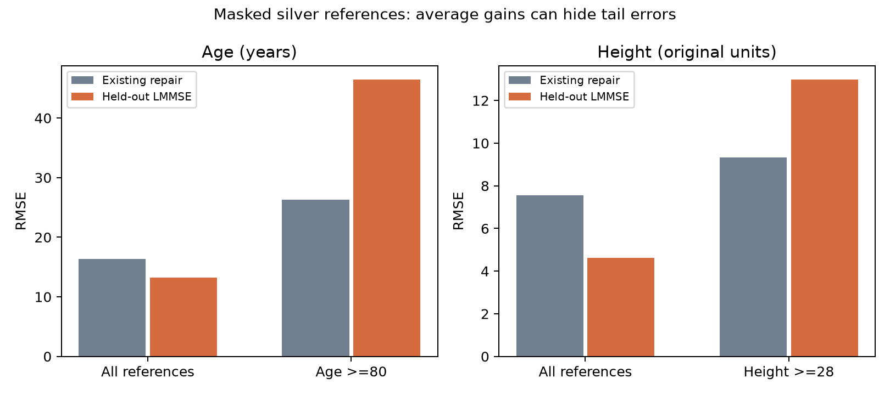

# 0.679 → 0.672：提交退步的證據分析與修正

日期：2026-10-24（臺北）。本次沒有重訓受損分類模型，沒有產生聲稱超過 0.680 的新預測，也沒有覆蓋舊提交。實際執行的是四份 CSV 比對、無受損標籤的量測估計、訓練標籤聚合範圍檢查，以及既有機率的 label-shift 診斷。

## 1. 先固定真正的成績與檔案

| 使用者提供的提交 | 使用者回報 Kaggle 分數 | 預測 Level 1/2/3 | 與 (3) 不同的列數 |
|---|---:|---|---:|
| (3) | **0.679** | 1700 / 1700 / 1700 | 0 |
| (4) | 0.677 | 1700 / 1700 / 1700 | 138 |
| (5) | 0.675 | 1617 / 1846 / 1637 | 179 |
| (6) | 0.672 | 1700 / 1700 / 1700 | 189 |

這些是使用者回報的 Kaggle 成績，沒有經 API 獨立查詢；榜單類型與精確未四捨五入分數未確認。OOF Balanced Accuracy 與 Kaggle Accuracy 是不同估計，不能直接當成同一分數。

保存的 `downloads/submission_recovery_known_best_0679.csv` 與 (3) **逐位元相同**，SHA256：
`61d3d73ee03aeb8bacf938fbdd2fa9673e38a7b7016d3aeaddf22c6413ebdc1f`。
這是復原已知最佳結果，不是新方法或新提升。

### 最新補充報告仍有版本對應衝突

已完整讀取三份報告：(4).md、(5).md，以及使用者指定對應 submission (3) 的 (6).md。三者 **11,297 bytes、SHA256 完全相同**：
`b8ce41643a99a0056c075de81f010da1f525ebb6358fe1e1243dc25b18125d98`。

它們標題皆為 V7，結尾寫 1617 / 1846 / 1637，並寫「相較 V6 改動 175 筆」；這兩個數字同時符合實際 **(4) → (5)**，不符合 (3) 的輸出分布。這能指出內容對應衝突，不能證明使用者如何命名或保存檔案。報告不是可執行程式，尚無法重現 (3) 的 OOF 與訓練程序。先前提供的程式標示 V6、參數標示 V5，也未能解決此缺口。不得將本專案另外重建的 baseline OOF 冒稱為 (3) 的 OOF。

## 2. 「修正 146 棟假陽性 Level 2」不是可驗證的結論

直接比對 (5) 與 (6)：

- 151 筆離開 Level 2：84 筆變成 Level 1、67 筆變成 Level 3。
- 5 筆進入 Level 2，因此 Level 2 **淨減 146 筆**。
- 另有 4 筆在 Level 1、3 之間互換，共 **160 筆改動**。

沒有 test 真實標籤，這些只能叫「改動」，不能叫「修正」。即使真實 Level 2 恰有 1700 筆，預測數減真實數等於 **FP₂ − FN₂**，不是 FP₂ 本身。

也不能把所有退步都歸咎於配額：(3) 本來就每類 1700；(5) 沒有這個輸出配額，仍低於 (4)。四份硬標籤 CSV 缺乏對應機率及逐項消融，不能分離 Wiener、軟標籤、模型權重、TE 與配額的個別因果效果。

`safe_decision.py` 已提供明確規則：一般輸入機率預設 argmax；只有外部確知各類總數時，才顯式傳入 counts，最佳化 **sum(p)**（期望正確筆數）。sum(log p) 最佳化的是另一個目標；`transport_objective_counterexample.json` 提供可重現反例。即使機率校準且配額正確，期望最佳也不保證這批測試資料的實現準確率最高。

## 3. Wiener / LMMSE：整體平均改善，尾端卻惡化

`wiener_audit.py` 在 train + test **20,100 筆 X** 上擬合線性最小均方估計；完整擬合的參數另行保存。主要比較採 5 折、seed 813：驗證列的主要物理值不參與參數估計，僅以代理欄位預測。這沒有用受損標籤，但使用 test X，屬明示的 transductive 量測診斷。

參考值是預先定義合理範圍內的原始屋齡／高度，稱為 **silver reference**；它們不等於經現場確認的真值。對真正被污染的列，原始真值不存在，所以不能驗證那些列的真實 RMSE。這裡也不是未提供實作的原版濾波器重現。

| 物理量 / 範圍 | 參考列數 | 既有修復 RMSE | Held-out LMMSE RMSE | 相較既有修復 |
|---|---:|---:|---:|---:|
| 屋齡：全部 | 18924 | 16.379 | 13.264 | **降低 19.02%** |
| 屋齡：≥80 年 | 346 | 26.266 | 46.444 | **增加 76.82%** |
| 高度：全部 | 18952 | 7.563 | 4.618 | **降低 38.94%** |
| 高度：≥28，依資料原始單位 | 556 | 9.318 | 12.978 | **增加 39.29%** |

若改用「原始代理值平均」作為基準，整體降幅會變成屋齡 **29.35%**、高度 **45.95%**。因此「22.2% / 38.9%」必須同時交代基準與參考真值；這次只在指定 silver 診斷與既有修復基準下得到高度約 38.9%，屋齡不是 22.2%。

高齡組 LMMSE 平均偏差約 −40.77 年，高樓組約 −11.68 原始單位。這表示整體 MSE 目標下的向平均收縮，可能犧牲少見的高風險樣本。它是值得檢查的機制，**不是已證實造成這次 Kaggle 退步的原因**。高尾端 silver 值亦可能含未識別污染。

純粹可逆的仿射重標度，本身未必損失資訊，重新訓練的彈性分類器可能完全適應。實際風險還包含分段覆寫、截斷、捨棄代理原始訊息、忽略不確定性與訓練／測試轉換不一致。修正原則是保留可信原值與缺損標記，修復值和不確定性另列，並以外層分類分數決定是否採用；不能僅因整體 RMSE 較低就取代全部物理輸入。

## 4. 雙胞胎衝突不等於錯標；軟標籤有範圍要求

本次明示一個部分物理簽章：村落 f_141、屋齡、樓層、f_182、f_214、屋頂、f_105、f_209。在這個定義下得到 **464 組、1107 列**衝突；這 464 組全部在其他物理欄位仍有差異，例如面積、高度或其他建材欄位。這個簽章不保證等同舊報告未提供的實作，也不能以此重現其 1028 組統計。

因此，部分欄位相同不能推出完整 X 相同，更不能推出這些標籤錯誤或宣稱完整模型的 Bayes accuracy 上限。將它們平均成軟標籤，可能抹除仍可辨識的差異。

即使完整 X 相同，把一組硬標籤改成類別頻率、再按組大小加權，其交叉熵與原始硬標籤的總交叉熵數學上相同；這本身不會自動消除錯標。若使用類別權重，軟標籤頻率與總權重也必須一致處理。

另一個風險是先在全 15,000 列計算軟標籤再切折。本次假設性檢查顯示，每折約 228–263 個訓練列的軟標籤會受外折標籤影響。**這是範圍風險示範，不是已發現未提供程式存在洩漏。** 正確做法是在每個外層及選模內層的訓練資料內重新建立聚合；外折標籤只評估。訓練目標使用自身標籤是正常監督學習，不能與 TE 特徵含自身標籤混為一談。

## 5. TE 一致性與重複選模，應先於更複雜的模型

V7 報告提到折內訓練 TE，測試推論混用全 15,000 列標籤 TE。全 train 標籤用於真正 test 並不自動構成洩漏；但若送進既有折模型的 TE 生成範圍、平滑或尺度與驗證不同，就有分布不一致。這種完整推論配方也必須在外層訓練資料內模擬，不能只驗證一種 TE 再部署另一種。

「一直調整直到同一組 OOF 超過 0.68201」也會選中驗證噪音。對同一組既有 OOF 做 200 次重抽樣，只能量化條件於這些預測的取樣變異，不能抹除前面反覆選模造成的偏差。外層標籤不可選超參數、模型權重、門檻、特徵或配額方案；已反覆查看過的外層結果也不能再叫全新盲測。

先前 phase5 的新 RBF 路線提供實際教訓：

| 切分 seed | OOF BA | Recall 1 / 2 / 3 | 對重建 reference 的 ΔBA |
|---|---:|---|---:|
| 42 | 0.677376 | .746499 / .567561 / .718068 | +.003072 |
| 2026 | 0.674536 | .738562 / .566628 / .718418 | **−.003580** |

42 的差值 95% 區間已跨零；2026 是在查看初次結果後，明示的額外探索檢查，不能冒稱預先註冊的獨立確認。第二個切分退步，所以此路線 No-Go，沒有生成新提交。詳細來源與偏離紀錄保存在 phase5。

## 6. 論文實際支持什麼

1. **Chi et al. (2020)**，*Machine learning-based seismic capability evaluation for school buildings*，Automation in Construction 118, 103274，[DOI](https://doi.org/10.1016/j.autcon.2020.103274)。已讀取使用者 PDF。資料是臺灣 **8951 棟校舍**、CDR 門檻的二元安全判定，不是本題三類尼泊爾受損程度。其 .861 是 weighted F1，.853 是 ROC-AUC，不能當作本題可達 Accuracy。可以借鏡物理特徵與只在訓練側重採樣；不能據此推導 Wiener、部分雙胞胎軟化或每類1700配額有效。原文也未充分交代嚴格 nested 調參，不能替我們的驗證背書。
2. **Lipton, Wang & Smola (2018)**，[Detecting and Correcting for Label Shift with Black Box Predictors](https://proceedings.mlr.press/v80/lipton18a.html)。已讀官方論文 PDF 的相關方法章節。需 p(x|y) 不變、來源涵蓋目標類別、混淆矩陣可逆。預測邊際比例不是直接等於真實比例，需匹配同模型的來源混淆矩陣。
3. **Cawley & Talbot (2010)**，[On Over-fitting in Model Selection and Subsequent Selection Bias in Performance Evaluation](https://www.jmlr.org/papers/v11/cawley10a.html)。原文 PDF 存取遭服務限制；本次核實引用並讀取 [scikit-learn 官方 nested CV 說明](https://scikit-learn.org/stable/auto_examples/model_selection/plot_nested_cross_validation_iris.html)，不宣稱已完整讀到該原文。原則是選模程序自身也會過擬合，需要把模型選擇包在評估內。

### 實際執行 soft BBSE 診斷

使用 phase5 已保存、每折訓練範圍匹配的 OOF／test 機率，沒有重訓或修改提交。估計 test 類別比例約：seed42 = **.317 / .347 / .336**，seed2026 = **.316 / .352 / .332**。每類的條件式 bootstrap 95% 區間都含 1/3。

這代表目前診斷**不能排除均勻先驗**，不代表能證明精確1700，也不證明 label-shift 假設成立。1000次重抽樣沒有包含重訓變異。它不是 (3) 的模型，不能把這個混淆矩陣移植到 (3)；(3) 缺匹配 OOF 與機率，所以未套用 BBSE 校正。

## 7. 已實作的修正與下一輪入口條件

- 固定保存已知最佳 (3)，不再用未通過驗證的新輸出覆蓋；附每份 CSV 的 SHA256、逐 ID 改動與完整轉移矩陣。
- 提供預設不推測配額的機率決策函式與相應測試；保留外部已知配額時 sum(p) 的明確選項。
- 提供 held-out 量測診斷，強制同看整體、尾端 RMSE 與偏差，不把 silver reference 冒充污染列真值。
- 提供部分簽章衝突與跨折軟標籤風險檢查，不自動刪除或平均疑似錯標列。
- 本輪不產生「新高分候選」。後續有效增量研究的入口，是先取得可執行的 (3) 程式／精確設定與匹配 OOF 機率，重現相同 submission hash，再預先固定一項修正與選模流程進行外層比較。這可避免把版本差異誤認為方法成效。

目前的可靠結論是修正了評估與因果敘述，並可復原 0.679；**沒有證據可以宣稱已找到 >0.680 的方法**。
