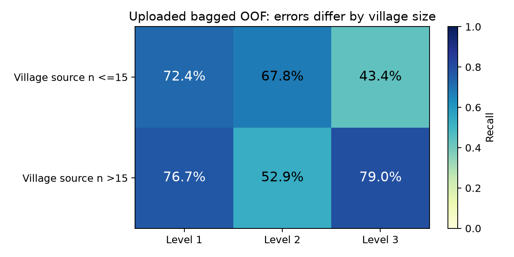

# V5 / V11：OOF 0.68107，Kaggle 0.672 的差距

2026-10-25（臺北）。使用者已確認：**本次 `submission_bagged_argmax_noquota.csv` 的 Kaggle 成績為 0.672**。這是使用者回報，未經 Kaggle API 查詢；不知道公榜實際計分列數。本輪沒有取得新的 Kaggle 成績。

**我目前沒有足夠信心宣稱下一份提交會超過 0.680。** 新資料讓診斷更具體，但沒有提供可安全輸出的新高分候選。不能以「直到有信心」代替驗證規則；需要如實保留失敗的比較。

## 1. 檔案確實對齊；V5 名稱仍不能證明是原始最佳版本

實際讀取並核對：

- OOF 15,000 列，ID **1..15000**，標籤與 repository 的 train.csv 全部一致。
- test / submission 5,100 列，ID **1..5100**，順序與 sample_submission 完全一致。
- 機率有限、非負；每列總和誤差至多約 1e-6，分析時僅將 CSV 四捨五入誤差正規化。
- Bagged 機率約等於 **0.65 V5 + 0.35 V11**，提交檔完全等於它的 argmax。沒有發現 ID 錯位、標籤錯位或提交格式錯誤。
- 新提交分布 **1633 / 1827 / 1640**；與原始已知 0.679 的 (3) 有 **250 列**不同，其中 207 列的新模型 top-2 margin ≤0.10，139 列 ≤0.05；沒有一列的新模型最高機率 ≥0.80。這些數字是改動的性質，不能辨識哪些改對或改錯。

原始 (3) 各類1700筆，但將這次 V5 的 test 機率做精確 sum(p) 配額解後，仍與 (3) **227 列不同**；sum(log p) 解仍不同228列。所以這次叫 V5 的機率，不能直接視作已重現原始 0.679 的流程；缺少原始輸出與後處理程式，尚無法確定差異發生在哪一環。

先前上傳的文字報告曾寫 ID 0..5099；這與本輪實際檔案不符。此處以實檔的1..5100為準。

## 2. 真實 OOF 分數與融合能帶來的有限改善

| 上傳模型 | OOF Balanced Accuracy | OOF Accuracy | Recall 1 | Recall 2 | Recall 3 |
|---|---:|---:|---:|---:|---:|
| V5 | .678623 | .675133 | .741363 | .596733 | .697772 |
| V11 | .680412 | .675467 | .746032 | .599300 | .695906 |
| .65 V5 + .35 V11 | **.681073** | .676667 | .746032 | .599067 | .698122 |

OOF BA 與 Kaggle Accuracy 不是相同的抽樣量；只有測試類別先驗均等、分類條件分布與推論程序足夠匹配時，BA 才可作為測試 Accuracy 的合理對應。測試真實先驗並沒有從標籤證實。

V5 / V11 的 OOF 對錯相關係數 **0.94755**，僅424列 argmax 不同。它們大多一起成功、一起失敗，繼續細調融合比例不能提供大量新資訊。

也實際利用先前已保存、對齊 ID 的六組模型，各比較25%與50%固定融合，**沒有重訓這些舊模型**。12個探索比較中，11個退步，唯一增加為 **+.000155 BA**，不構成可採用的提升。這些快取來自不同且已使用過的研究切分，不能拿來冒充新的嚴格 nested 驗證。

### 0.68107 不是穩定超過0.680的證據

對已提供、固定的 OOF 預測做條件式 bootstrap：

| 重抽樣方式 | Bagged BA 的95%區間 |
|---|---|
| 按類別抽列 | .67248 – .68948 |
| 按村落整群抽樣 | **.66658 – .69353** |

村落內誤差會相關，逐列抽樣可能低估不確定性。以上兩種區間都沒有包含模型重訓、歷次選模、OOF生成程序不明及 Kaggle 計分子集的不確定性，**不是 Kaggle 分數的信賴區間，也不是超過0.680的機率**。本地小幅超標不足以支持有把握的承諾。

## 3. 真正的錯誤結構：小村落 Level 3、大村落 Level 2

以下村落大小是全 train X 的村落筆數，用於描述；它不是未提供的各原始 OOF 折內實際可見筆數。

| OOF 子群 | 筆數 | Recall 1 | Recall 2 | Recall 3 |
|---|---:|---:|---:|---:|
| 村落樣本≤15 | 5271 | .72361 | **.67771** | **.43427** |
| 村落樣本>15 | 9729 | .76727 | **.52874** | .78954 |

全體 Level 2 的錯誤為808筆判成1、910筆判成3。但進一步拆開：

- 小村落 Level 2：451筆判成1、201筆判成3。
- 大村落 Level 2：357筆判成1、709筆判成3。

因此，兩個子群的偏誤方向不同。全域提高／降低 Level 2 權重或強制改回1700，可能同時幫到一群、傷到另一群。小村落最突出的弱點其實是 **Level 3 召回不足**，不能只追全體 Level 2。

屋齡異常標記子群的 BA 約 .68903，並沒有在這份 OOF 中呈現「所有受污染列普遍特別差」的結果；這不能證明修復完美，但目前不足以把增加 Wiener 修復複雜度排在首位。高齡子群的 Level 1 召回很低，該子群 Level 1 只有20列，解讀要保留樣本量限制。

### 測試集對小村落暴露較高

- 原始 train 小村落比例：35.14%。
- 將 source 各真實類別等權後：**40.53%**。
- test 小村落比例：**45.76%**。

類別均衡能解釋一部分差距，仍留下約5.24個百分點的群體組成差異；不能只比較原始 train / test 比例就把全部差距歸為 covariate shift，也不能假定類別平衡後完全沒有差異。

`transport_risk.py` 做了一個**敏感度試算**：假設目標類別各1/3、小村落機率在三類採相同 log-odds 位移、各類別與村落大小條件下的召回不變，將小村落暴露調至45.76%。計算值從 .68107 變為 **.67770**。

**.67770 不是新的驗證分數、Kaggle 預測或已校正的真實準確率。** 假設未被證實，群體定義與原始折範圍也未知。它只示範：當表現弱的群體在測試集更多，總 OOF 略高於.680仍可能不夠。這個試算沒有依0.672反向調參，也沒有用來修改提交。

## 4. 逐一執行的修正比較與淘汰結果

### A. 簡單機率校準：沒有增益，停止採用

以平衡交叉熵擬合一個共享 logit 尺度與兩個截距，只有三個參數，沒有做門檻網格搜尋。三種 meta 交叉擬合結果：

| 切分 | BA | 對原 Bagged 的差值 |
|---|---:|---:|
| 5折 stratified seed42 | .680413 | −.000661 |
| 5折 stratified seed2026 | .680412 | −.000661 |
| 村落整群5折 | .680412 | −.000661 |

**這不是嚴格的 base+meta nested 驗證**。校準器沒看自己 meta 驗證列的標籤，不代表其他列的 base OOF 預測沒曾用到這些標籤。原始 base fold / 訓練程式不明，更無法重建缺少的內層預測。因此這只支持「這個低成本校準診斷沒有改善」，不能用來為新候選背書。

### B. 類別先驗校正：估計不夠確定，不套用

以這次提供的機率做 soft BBSE 診斷，Bagged 的目標先驗估計約 **.317 / .348 / .335**，三個條件式95%區間都涵蓋1/3。V5、V11也相同。

BBSE 需要 class-conditional X 分布穩定，且來源／測試模型與特徵轉換匹配。本輪沒取得原始逐折機率與 TE 程式，這些前提無法查證；小村落暴露差異亦提醒不能直接假定只有 label shift。**不因模型多判 Level 2 就估計真實 Level 2 更多，也不套用尚未驗證的先驗調整。**

### C. 額外分布加權：缺乏支持，不直接用在提交

以 X-only 的固定 Logistic domain classifier 區分 train / test，排除 ID，預處理只在 domain 訓練部分擬合：

- 使用原始 train：domain AUC **.59016**。
- 將 source 按類別等量抽樣：domain AUC **.50905**。

這表示簡單線性分布診斷的可辨識差異，在類別平衡後大幅降低。它不能證明沒有非線性或子群差異，也不是 TE 一致性的測試。沒有因此生成 importance weights 或擬造修正效果。

### D. 新的無 TE 原生類別 LightGBM：小型篩選失敗，停止擴訓

在看結果前，將單一模型設定與篩選門檻寫入 `native_protocol.json`：直接處理地理類別、保留代理與可信物理輸入、平衡損失；不使用 TE、軟標籤、Wiener覆寫或配額。

使用與既有快取 reference **相同訓練／驗證列**，只訓練這一個固定新設定：

- BA **.668992**，Recall **.66045 / .61251 / .73402**。
- 相同切分 cached reference BA .687803，差值 **−.018811**。
- 訓練加預測約3.55秒；未達事先門檻，沒有跑外層5折、沒有微調參數補救、沒有產生CSV。

這淘汰的是該固定設定，不能推出所有 LightGBM 或所有無 TE 方法都不可行。這個篩選資料已用於過往研究，也不能稱作獨立盲測。

## 5. 目前最有效的解決順序

| 優先 | 問題 | 具體下一步 | 此輪狀態 |
|---|---|---|---|
| 1 | 最佳版本與新V5對應不明 | 取得產生本次機率的完整程式／設定，及原始(3)對應流程；重現輸出 hash | **缺必要來源**，不能從機率反推出訓練過程 |
| 2 | OOF／test TE與重訓配方可能不同 | 保存每折模型、特徵／TE擬合範圍、折內test機率，使用同一折模型與同一映射產生val/test | 程式未提供，不能判定有無此問題 |
| 3 | 小村落L3／大村落L2的不同弱點 | 先在完整外層內重現子群誤差及test暴露；以預先固定的群體風險指標評估改進，不能用外折標籤調子群權重 | 子群與敏感度診斷已完成 |
| 4 | 融合／校準／硬配額的低效反覆調整 | 固定候選數量與淘汰規則，避免把OOF噪音當增益 | 12個快取融合、3種校準診斷與1個新模型篩選均未獲採用 |
| 5 | 分數不確定性與反覆選模 | 明確區分條件式重抽樣、重訓變異與真正未使用的評估；最終Kaggle分數只能由實際提交確認 | 已記錄限制，沒有宣稱通過 |

拿到每列 fold 編號是追查來源的第一步，**單有 fold 編號仍不能把一份既有OOF變成嚴格nested資料**。若 meta 選模要用內層預測，仍需在每個外層訓練範圍重新產生相應的 inner OOF。

本輪的修正是淘汰沒有證據的方向、收斂到可定位的兩種群體弱點與訓練／推論一致性問題。原始0.679及所有舊結果未被覆蓋。**沒有輸出新的 submission，不把未通過驗證的方法包裝成突破0.680。**

## 6. 文獻使用範圍

- Lipton, Wang & Smola (2018), [Detecting and Correcting for Label Shift with Black Box Predictors](https://proceedings.mlr.press/v80/lipton18a.html)：採用其 BBSE 假設與矩陣關係做診斷，未把估計當作真實配額。相關原文已於phase6讀取。
- Cawley & Talbot (2010), [On Over-fitting in Model Selection and Subsequent Selection Bias in Performance Evaluation](https://www.jmlr.org/papers/v11/cawley10a.html)：重複調整驗證分數會造成選模偏差。原文PDF先前存取受限；本次引用及nested原則沿用已讀的 [scikit-learn 官方說明](https://scikit-learn.org/stable/auto_examples/model_selection/plot_nested_cross_validation_iris.html)，不宣稱讀過其完整原文。
- 使用者校舍論文 Chi et al. (2020), DOI [10.1016/j.autcon.2020.103274](https://doi.org/10.1016/j.autcon.2020.103274)：臺灣校舍二元任務，不能以其 weighted F1 換算本題三類Accuracy；詳見phase6文獻核對。
